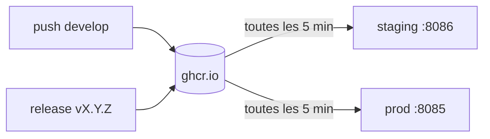

# Déploiement continu sur le VPS GreenIT — Plan d'implémentation

> **For agentic workers:** REQUIRED SUB-SKILL: Use superpowers:subagent-driven-development (recommended) or superpowers:executing-plans to implement this plan task-by-task. Steps use checkbox (`- [ ]`) syntax for tracking.

**Goal:** Publier les images backend et frontend sur ghcr.io à chaque push sur `develop` et à chaque release. Le VPS GreenIT les tire toutes les 5 minutes, en staging (`develop`) et en prod (dernière release). Il revient en arrière automatiquement et alerte Mattermost en cas d'échec.

**Architecture:** Option C de l'issue #29, voir le spec `.superpowers/specs/2026-11-11-deploiement-vps-design.md`.
- Un workflow réutilisable `build-images.yml` est le seul à construire. Il est appelé par `images-develop.yml` (push `develop`) et par `release.yml` (tag `vX.Y.Z`).
- Sur le VPS, un timer systemd lance `deploy/update.sh <env>` toutes les 5 minutes. Le script compare, bascule, contrôle, revient en arrière et alerte.
- Aucun accès de GitHub au serveur.

**Tech Stack:** GitHub Actions, Docker Buildx, ghcr.io, Docker Compose v2, Bash, jq, systemd, YunoHost (app Redirect), Vite et Vitest.

## Global Constraints

- **Phase 1 (tâches 1 à 8)** : code et PR vers `develop`, exécutés par le Développeur.
- **Phase 2 (tâches 9 à 13)** : actions sur le VPS et hors VPS. Aucune ne commence sans la **validation explicite de Renaud**, donnée pour la tâche concernée. Toute commande vient de `deploy/README.md`. Si une commande diffère à l'exécution, le README est corrigé dans une PR.
- Le `docker-compose.yml` racine ne change pas.
- Le `.gitignore` ignore `.env.*` : le modèle s'appelle donc `deploy/env.example`, et non `deploy/.env.example`. Le `.gitignore` ne change pas.
- Le `.env` contient l'URL du webhook, qui est un secret. Elle ne doit jamais apparaître dans une PR, une issue, un log de CI ou un chat. Pour afficher un `.env`, on exclut cette ligne avec `grep -v ALERT_WEBHOOK_URL`.
- Versions des actions : `actions/checkout@v7`, `docker/setup-buildx-action@v4`, `docker/login-action@v4`, `docker/metadata-action@v6`, `docker/build-push-action@v7`. Les actions déjà présentes dans `release.yml` ne changent pas.
- Écoconception (ecocode appliqué aux fichiers de build) :
  - images `linux/amd64` seulement ;
  - cache Buildx `type=gha` par service ;
  - purge des images du projet après chaque bascule ;
  - logs limités à 50 Mo par conteneur ;
  - aucun téléchargement d'image quand rien n'a changé.
- Les messages de commit suivent la convention du dépôt (`feat:`, `ci:`, `docs:`, `test:`), en français.

---

### Task 1: Version affichée avec le commit en staging

**Files:**
- Create: `frontend/src/appVersion.ts`
- Create: `frontend/tests/appVersion.test.ts`
- Modify: `frontend/vite.config.ts`
- Modify: `frontend/Dockerfile.prod`

**Interfaces:**
- Produces: `appVersion(packageVersion: string, appBuild?: string): string`. Le résultat est `X.Y.Z+sha.<build>` si `appBuild` est non vide, sinon `X.Y.Z`.
- Produces: argument de build Docker `APP_BUILD`, utilisé par la tâche 5.

- [ ] **Step 1: Écrire le test qui échoue**

`frontend/tests/appVersion.test.ts` :

```ts
import { describe, expect, it } from "vitest";
import { appVersion } from "../src/appVersion";

describe("appVersion", () => {
  it("returns the package version when no build is given", () => {
    expect(appVersion("0.4.0")).toBe("0.4.0");
  });

  it("ignores an empty or blank build", () => {
    expect(appVersion("0.4.0", "")).toBe("0.4.0");
    expect(appVersion("0.4.0", "  ")).toBe("0.4.0");
  });

  it("appends the commit as build metadata", () => {
    expect(appVersion("0.4.0", "ab12cd3")).toBe("0.4.0+sha.ab12cd3");
  });
});
```

- [ ] **Step 2: Vérifier l'échec**

Run: `cd frontend && npx vitest run tests/appVersion.test.ts`
Expected: FAIL, car le module `../src/appVersion` est introuvable.

- [ ] **Step 3: Écrire le module**

`frontend/src/appVersion.ts` :

```ts
// Version shown in the footer. Staging images are built with APP_BUILD set to
// the short commit (see .github/workflows/images-develop.yml), so the footer
// proves which commit is running; release images leave it empty.
export function appVersion(packageVersion: string, appBuild?: string): string {
  const build = appBuild?.trim();
  return build ? `${packageVersion}+sha.${build}` : packageVersion;
}
```

- [ ] **Step 4: Brancher Vite**

Dans `frontend/vite.config.ts`, ajouter l'import et remplacer la valeur de `__APP_VERSION__` :

```ts
import { appVersion } from "./src/appVersion";
```

```ts
  // Site version shown in the footer, kept in sync by Changesets
  // (scripts/sync-versions.mjs): written into the bundle, no request needed.
  // APP_BUILD (Docker build arg) adds the commit on staging images.
  define: {
    __APP_VERSION__: JSON.stringify(appVersion(packageJson.version, process.env.APP_BUILD)),
  },
```

- [ ] **Step 5: Déclarer l'argument de build**

Dans `frontend/Dockerfile.prod`, juste avant `RUN npm run build` :

```dockerfile
# Commit court affiché dans le pied de page en staging (vide en release).
ARG APP_BUILD=""
```

L'`ARG` est placé après `COPY . .` pour ne pas invalider le cache de `npm ci`.

- [ ] **Step 6: Vérifier**

Run: `cd frontend && npx vitest run && npm run build`
Expected: tous les tests passent, y compris `Footer.test.tsx` qui compare à `package.json`, et le build réussit.

Run: `cd frontend && APP_BUILD=ab12cd3 npx vite build && grep -o '0\.[0-9]*\.[0-9]*+sha\.ab12cd3' dist/assets/*.js | head -n 1`
Expected: la version suivie de `+sha.ab12cd3` est trouvée.

- [ ] **Step 7: Commit**

```bash
git add frontend/src/appVersion.ts frontend/tests/appVersion.test.ts frontend/vite.config.ts frontend/Dockerfile.prod
git commit -m "feat: version suivie du commit dans le pied de page du staging"
```

---

### Task 2: Compose de déploiement et modèle de `.env`

**Files:**
- Create: `deploy/compose.yml`
- Create: `deploy/env.example`

**Interfaces:**
- Consumes: images `ghcr.io/cnumr/ai-calculator-{backend,frontend}:<tag>` (tâche 5).
- Produces: variables `.env` `COMPOSE_PROJECT_NAME`, `HTTP_PORT`, `IMAGE_TAG`, `ALERT_WEBHOOK_URL`. `update.sh` écrit en plus `PREVIOUS_TAG`, `PINNED` et `FAILED_TARGET`.

- [ ] **Step 1: Écrire `deploy/compose.yml`**

```yaml
# Déploiement sur le VPS GreenIT à partir des images ghcr.io (voir deploy/README.md).
# Le docker-compose.yml racine (build local) reste celui des autres serveurs.
# Variables lues dans le .env du dossier : IMAGE_TAG, HTTP_PORT, COMPOSE_PROJECT_NAME.

# Logs des conteneurs limités à 5 fichiers de 10 Mo, avec rotation automatique.
x-logging: &logging
  driver: local
  options:
    max-size: "10m"
    max-file: "5"

services:
  backend:
    image: ghcr.io/cnumr/ai-calculator-backend:${IMAGE_TAG:?IMAGE_TAG manquant dans .env}
    restart: unless-stopped
    logging: *logging
    healthcheck:
      # L'image n'a pas curl : contrôle en Python (bibliothèque standard).
      test:
        - CMD
        - python
        - -c
        - "import urllib.request; urllib.request.urlopen('http://127.0.0.1:8000/api/use-cases', timeout=4)"
      interval: 60s
      timeout: 5s
      retries: 3
      start_period: 30s
      start_interval: 2s

  frontend:
    image: ghcr.io/cnumr/ai-calculator-frontend:${IMAGE_TAG:?IMAGE_TAG manquant dans .env}
    restart: unless-stopped
    logging: *logging
    ports:
      # Écoute locale seulement : l'app YunoHost Redirect publie le domaine en HTTPS.
      - "127.0.0.1:${HTTP_PORT:?HTTP_PORT manquant dans .env}:80"
    depends_on:
      backend:
        condition: service_healthy
    healthcheck:
      test: ["CMD", "wget", "-qO", "/dev/null", "http://127.0.0.1/api/use-cases"]
      interval: 60s
      timeout: 5s
      retries: 3
      start_period: 10s
      start_interval: 2s
```

- [ ] **Step 2: Écrire `deploy/env.example`**

```dotenv
# Modèle du fichier /srv/ai-calculator-<env>/.env (propriétaire ai-calculator, mode 600).
# Voir deploy/README.md. Valeurs ci-dessous : staging.
COMPOSE_PROJECT_NAME=ai-calculator-staging
HTTP_PORT=8086
# staging : develop ; prod : laisser vide à l'installation, update.sh écrit la dernière release.
IMAGE_TAG=develop
# Webhook entrant Mattermost (secret). Vide : pas d'alerte, logs seulement.
ALERT_WEBHOOK_URL=
# Écrits par update.sh, ne pas modifier à la main :
# PREVIOUS_TAG=  PINNED=  FAILED_TARGET=
```

- [ ] **Step 3: Vérifier**

Run: `docker compose -f deploy/compose.yml --env-file deploy/env.example config --quiet && echo ok`
Expected: `ok`.

Run: `docker compose -f deploy/compose.yml --env-file deploy/env.example config | grep -E 'image:|127.0.0.1:8086|driver: local'`
Expected: les deux images en `:develop`, le port `127.0.0.1:8086` et deux fois `driver: local`.

- [ ] **Step 4: Commit**

```bash
git add deploy/compose.yml deploy/env.example
git commit -m "feat: compose de déploiement à partir des images ghcr.io"
```

---

### Task 3: Script `deploy/update.sh` et ses tests

**Files:**
- Create: `deploy/tests/fake-bin/docker`
- Create: `deploy/tests/fake-bin/curl`
- Create: `deploy/tests/update_test.sh`
- Create: `deploy/update.sh`

**Interfaces:**
- Produces: `update.sh <staging|prod> [vX.Y.Z|--unpin] [--dry-run] [--verbose]`.
  - Codes de sortie : `0` (rien à faire, bascule réussie, attente), `1` (échec de déploiement, version demandée introuvable, `.env` absent), `2` (usage).
  - Variables d'environnement de test : `AIC_RELEASES_URL`, `AIC_CHECK_TRIES`, `AIC_CHECK_INTERVAL`.
- Produces: `bash deploy/tests/update_test.sh` (utilisé en CI, tâche 5).

Comportement, conforme au spec mis à jour :
- **staging** : `pull`. Si les conteneurs tournent déjà sur les images locales `:develop`, rien à faire. Si ces images sont celles d'un échec précédent (`FAILED_TARGET`), on attend un nouveau push. Sinon on redémarre et on contrôle. En cas d'échec, on écrit `FAILED_TARGET` et on alerte, sans retour arrière.
- **prod** : on prend comme cible la dernière release, ou la version passée en argument (qui fige la prod avec `PINNED=true`). Une release déjà en échec (`FAILED_TARGET`) n'est pas retentée. Une image pas encore publiée est attendue, sans alerte. La bascule est suivie d'un contrôle. En cas d'échec, on revient à la version précédente et on alerte.
- `--dry-run` : aucune écriture, aucun `pull`, aucun `up`.

- [ ] **Step 1: Écrire le faux `docker`**

`deploy/tests/fake-bin/docker` :

```bash
#!/usr/bin/env bash
# Faux docker pour deploy/tests/update_test.sh. Il simule, dans $FAKE_STATE :
#   remote/<svc>:<tag>  images publiées sur ghcr.io (contenu = identifiant)
#   local/<svc>:<tag>   images téléchargées sur le serveur
#   running/<svc>       image du conteneur en service
#   broken              identifiants d'images dont l'API ne répond pas
#   calls               journal des appels
set -euo pipefail
S="$FAKE_STATE"
echo "docker $*" >>"$S/calls"

# ghcr.io/cnumr/ai-calculator-backend:v1.0.0 -> backend:v1.0.0
key() { echo "${1#ghcr.io/cnumr/ai-calculator-}"; }

case "$1" in
  manifest) [[ -f "$S/remote/$(key "$3")" ]] ;;
  inspect)
    cid="${!#}"
    cat "$S/running/${cid#cid-}"
    ;;
  image)
    case "$2" in
      inspect)
        k="$(key "${!#}")"
        [[ -f "$S/local/$k" ]] || exit 1
        if [[ $4 == *revision* ]]; then echo "abcdef1234567"; else cat "$S/local/$k"; fi
        ;;
      prune) ;;
    esac
    ;;
  compose)
    shift
    env_file=""
    while [[ $1 == --project-directory || $1 == -f || $1 == --env-file ]]; do
      if [[ $1 == --env-file ]]; then env_file="$2"; fi
      shift 2
    done
    tag="$(grep -E '^IMAGE_TAG=' "$env_file" | tail -n 1 | cut -d= -f2)"
    case "$1" in
      ps) if [[ -f "$S/running/$3" ]]; then echo "cid-$3"; fi ;;
      pull)
        for svc in backend frontend; do
          cp "$S/remote/$svc:$tag" "$S/local/$svc:$tag"
        done
        ;;
      up)
        for svc in backend frontend; do
          [[ -f "$S/local/$svc:$tag" ]] || cp "$S/remote/$svc:$tag" "$S/local/$svc:$tag"
          cp "$S/local/$svc:$tag" "$S/running/$svc"
        done
        ! grep -qxF "$(cat "$S/running/backend")" "$S/broken" 2>/dev/null
        ;;
      logs) echo "logs simulés" ;;
    esac
    ;;
esac
```

- [ ] **Step 2: Écrire le faux `curl`**

`deploy/tests/fake-bin/curl` :

```bash
#!/usr/bin/env bash
# Faux curl pour deploy/tests/update_test.sh (voir fake-bin/docker pour $FAKE_STATE).
#   release   tag renvoyé par l'API GitHub (absent = API en erreur)
#   alerts    corps des alertes reçues par le webhook
set -euo pipefail
S="$FAKE_STATE"
url="${!#}"
echo "curl $*" >>"$S/calls"

case "$url" in
  */releases/latest)
    [[ -f "$S/release" ]] || exit 22
    printf '{"tag_name":"%s"}\n' "$(cat "$S/release")"
    ;;
  */api/use-cases)
    [[ -f "$S/running/backend" ]] || exit 7
    if grep -qxF "$(cat "$S/running/backend")" "$S/broken" 2>/dev/null; then exit 22; fi
    echo '[]'
    ;;
  *) cat >>"$S/alerts" ;;
esac
```

- [ ] **Step 3: Écrire les tests**

`deploy/tests/update_test.sh` :

```bash
#!/usr/bin/env bash
# Tests de deploy/update.sh avec un faux docker et un faux curl : aucun réseau,
# aucun conteneur. Prérequis : bash, jq, flock (util-linux).
# Lancer : bash deploy/tests/update_test.sh
set -euo pipefail

HERE="$(cd "$(dirname "${BASH_SOURCE[0]}")" && pwd)"
FAILS=0
STATUS=0
OUT=""

PROD_ENV='COMPOSE_PROJECT_NAME=ai-calculator-prod
HTTP_PORT=8085
IMAGE_TAG=v0.4.0
ALERT_WEBHOOK_URL=https://chat.example/hooks/test'

STAGING_ENV='COMPOSE_PROJECT_NAME=ai-calculator-staging
HTTP_PORT=8086
IMAGE_TAG=develop
ALERT_WEBHOOK_URL=https://chat.example/hooks/test'

# Nouvel environnement vide, avec le .env donné.
setup() {
  WORK="$(mktemp -d)"
  export FAKE_STATE="$WORK/state"
  mkdir -p "$FAKE_STATE/remote" "$FAKE_STATE/local" "$FAKE_STATE/running"
  cp "$HERE/../update.sh" "$WORK/update.sh"
  : >"$WORK/compose.yml"
  printf '%s\n' "$1" >"$WORK/.env"
}

# publish TAG ID : les deux images du tag existent sur ghcr.io.
publish() {
  local svc
  for svc in backend frontend; do echo "$2" >"$FAKE_STATE/remote/$svc:$1"; done
}

# serving TAG ID : les conteneurs tournent sur ces images.
serving() {
  local svc
  for svc in backend frontend; do
    echo "$2" >"$FAKE_STATE/local/$svc:$1"
    echo "$2" >"$FAKE_STATE/running/$svc"
  done
}

release() { echo "$1" >"$FAKE_STATE/release"; }
broken() { echo "$1" >>"$FAKE_STATE/broken"; }

# Lance update.sh ; garde la sortie dans OUT et le code de sortie dans STATUS.
run_update() {
  : >"$FAKE_STATE/calls"
  STATUS=0
  OUT="$(PATH="$HERE/fake-bin:$PATH" AIC_CHECK_TRIES=2 AIC_CHECK_INTERVAL=0 \
    AIC_RELEASES_URL=https://api.example/releases/latest \
    "$WORK/update.sh" "$@" 2>&1)" || STATUS=$?
}

env_value() { grep -E "^$1=" "$WORK/.env" | tail -n 1 | cut -d= -f2- || true; }
running_image() { cat "$FAKE_STATE/running/backend"; }
started() { grep -q " up -d" "$FAKE_STATE/calls"; }
alerted() { [[ -f "$FAKE_STATE/alerts" ]] && grep -qF "$1" "$FAKE_STATE/alerts"; }
not() { ! "$@"; }

check() {
  local name="$1"
  shift
  if "$@"; then
    echo "ok   - $name"
  else
    echo "FAIL - $name"
    echo "       sortie : $OUT"
    FAILS=$((FAILS + 1))
  fi
}

echo "# prod : nouvelle release"
setup "$PROD_ENV"; serving v0.4.0 img-4; publish v0.4.0 img-4; publish v0.5.0 img-5; release v0.5.0
run_update prod
check "sort sans erreur" [ "$STATUS" -eq 0 ]
check "IMAGE_TAG passe à v0.5.0" [ "$(env_value IMAGE_TAG)" = v0.5.0 ]
check "PREVIOUS_TAG garde v0.4.0" [ "$(env_value PREVIOUS_TAG)" = v0.4.0 ]
check "les conteneurs tournent sur v0.5.0" [ "$(running_image)" = img-5 ]
check "les images inutiles sont purgées" grep -q "image prune -af --filter label=org.opencontainers.image.source=https://github.com/cnumr/ai-calculator" "$FAKE_STATE/calls"
check "aucune alerte" [ ! -f "$FAKE_STATE/alerts" ]

echo "# prod : rien à faire"
run_update prod
check "aucun redémarrage" not started

echo "# prod : release cassée, retour arrière"
setup "$PROD_ENV"; serving v0.4.0 img-4; publish v0.4.0 img-4; publish v0.5.0 img-5; broken img-5; release v0.5.0
run_update prod
check "code de sortie non nul" [ "$STATUS" -ne 0 ]
check "IMAGE_TAG revient à v0.4.0" [ "$(env_value IMAGE_TAG)" = v0.4.0 ]
check "les conteneurs reviennent sur v0.4.0" [ "$(running_image)" = img-4 ]
check "FAILED_TARGET vaut v0.5.0" [ "$(env_value FAILED_TARGET)" = v0.5.0 ]
check "alerte de retour arrière" alerted "v0.5.0 en échec, retour à v0.4.0"
rm "$FAKE_STATE/alerts"
run_update prod
check "la release en échec n'est pas retentée" not started
check "pas de nouvelle alerte" [ ! -f "$FAKE_STATE/alerts" ]
publish v0.5.1 img-51; release v0.5.1
run_update prod
check "une nouvelle release est déployée" [ "$(env_value IMAGE_TAG)" = v0.5.1 ]
check "FAILED_TARGET est effacé" [ -z "$(env_value FAILED_TARGET)" ]

echo "# prod : retour arrière impossible"
setup "$PROD_ENV"; serving v0.4.0 img-4; publish v0.4.0 img-4; publish v0.5.0 img-5; broken img-5; broken img-4; release v0.5.0
run_update prod
check "code de sortie non nul" [ "$STATUS" -ne 0 ]
check "alerte prod indisponible" alerted "indisponible : v0.5.0 en échec, retour à v0.4.0 en échec aussi"

echo "# prod : image pas encore publiée"
setup "$PROD_ENV"; serving v0.4.0 img-4; publish v0.4.0 img-4; release v0.5.0
run_update prod
check "sort sans erreur" [ "$STATUS" -eq 0 ]
check "IMAGE_TAG reste v0.4.0" [ "$(env_value IMAGE_TAG)" = v0.4.0 ]
check "aucun redémarrage" not started
check "aucune alerte" [ ! -f "$FAKE_STATE/alerts" ]

echo "# prod : API GitHub en erreur"
setup "$PROD_ENV"; serving v0.4.0 img-4; publish v0.4.0 img-4
run_update prod
check "sort sans erreur" [ "$STATUS" -eq 0 ]
check "aucun redémarrage" not started
check "avertissement écrit" grep -q "illisible" <<<"$OUT"

echo "# prod : version figée à la main, puis --unpin"
setup "$PROD_ENV"; serving v0.4.0 img-4; publish v0.4.0 img-4; publish v0.3.0 img-3; publish v0.5.0 img-5; release v0.5.0
run_update prod v0.3.0
check "IMAGE_TAG passe à v0.3.0" [ "$(env_value IMAGE_TAG)" = v0.3.0 ]
check "PINNED=true" [ "$(env_value PINNED)" = true ]
run_update prod
check "la tâche planifiée garde v0.3.0" [ "$(env_value IMAGE_TAG)" = v0.3.0 ]
check "message version figée" grep -q "version figée sur v0.3.0" <<<"$OUT"
run_update prod --unpin
check "--unpin revient à la dernière release" [ "$(env_value IMAGE_TAG)" = v0.5.0 ]
check "PINNED est retiré" [ -z "$(env_value PINNED)" ]

echo "# prod : version demandée introuvable"
setup "$PROD_ENV"; serving v0.4.0 img-4; publish v0.4.0 img-4
run_update prod v9.9.9
check "code de sortie non nul" [ "$STATUS" -ne 0 ]
check "PINNED n'est pas écrit" [ -z "$(env_value PINNED)" ]

echo "# prod : --dry-run"
setup "$PROD_ENV"; serving v0.4.0 img-4; publish v0.4.0 img-4; publish v0.5.0 img-5; release v0.5.0
before="$(cat "$WORK/.env")"
run_update prod --dry-run
check "annonce la bascule" grep -q "basculerait de v0.4.0 vers v0.5.0" <<<"$OUT"
check ".env inchangé" [ "$(cat "$WORK/.env")" = "$before" ]
check "aucun redémarrage" not started

echo "# staging : à jour"
setup "$STAGING_ENV"; serving develop img-a; publish develop img-a
run_update staging
check "sort sans erreur" [ "$STATUS" -eq 0 ]
check "aucun redémarrage" not started

echo "# staging : nouveau push"
setup "$STAGING_ENV"; serving develop img-a; publish develop img-b
run_update staging
check "sort sans erreur" [ "$STATUS" -eq 0 ]
check "les conteneurs tournent sur la nouvelle image" [ "$(running_image)" = img-b ]

echo "# staging : push cassé"
setup "$STAGING_ENV"; serving develop img-a; publish develop img-b; broken img-b
run_update staging
check "code de sortie non nul" [ "$STATUS" -ne 0 ]
check "alerte staging" alerted "déploiement de abcdef1 en échec"
check "FAILED_TARGET est écrit" [ -n "$(env_value FAILED_TARGET)" ]
rm "$FAKE_STATE/alerts"
run_update staging
check "le push cassé n'est pas retenté" not started
check "pas de nouvelle alerte" [ ! -f "$FAKE_STATE/alerts" ]

echo "# arguments"
setup "$PROD_ENV"
run_update staging v1.0.0
check "staging refuse une version" [ "$STATUS" -eq 2 ]
run_update
check "environnement obligatoire" [ "$STATUS" -eq 2 ]

if ((FAILS > 0)); then
  echo "${FAILS} test(s) en échec"
  exit 1
fi
echo "tous les tests passent"
```

- [ ] **Step 4: Rendre les faux binaires exécutables et vérifier l'échec**

```bash
chmod +x deploy/tests/fake-bin/docker deploy/tests/fake-bin/curl deploy/tests/update_test.sh
bash deploy/tests/update_test.sh
```

Expected: échec, car `cp` ne trouve pas `deploy/update.sh`.

- [ ] **Step 5: Écrire `deploy/update.sh`**

````bash
#!/usr/bin/env bash
# Met à jour un environnement ai-calculator (staging ou prod) à partir des
# images publiées sur ghcr.io. Lancé toutes les 5 min par
# ai-calculator-update@<env>.timer. Procédure complète : deploy/README.md.
#
#   update.sh <staging|prod> [--dry-run] [--verbose]
#   update.sh prod vX.Y.Z      fige la prod sur cette version (PINNED=true)
#   update.sh prod --unpin     reprend le suivi de la dernière release
set -euo pipefail

readonly REPO="cnumr/ai-calculator"
readonly IMAGE_BASE="ghcr.io/cnumr/ai-calculator"
readonly SERVICES=(backend frontend)
# Surchargeables pour les tests (deploy/tests/update_test.sh).
readonly RELEASES_URL="${AIC_RELEASES_URL:-https://api.github.com/repos/${REPO}/releases/latest}"
readonly CHECK_TRIES="${AIC_CHECK_TRIES:-12}"
readonly CHECK_INTERVAL="${AIC_CHECK_INTERVAL:-5}"

DIR="$(cd "$(dirname "${BASH_SOURCE[0]}")" && pwd)"
readonly DIR
readonly ENV_FILE="${DIR}/.env"
readonly COMPOSE=(docker compose --project-directory "$DIR" -f "${DIR}/compose.yml" --env-file "$ENV_FILE")

ENV_NAME=""
TARGET_ARG=""
DRY_RUN=false
VERBOSE=false

usage() {
  echo "usage : update.sh <staging|prod> [vX.Y.Z|--unpin] [--dry-run] [--verbose]" >&2
  exit 2
}

log() { echo "[${ENV_NAME}] $*"; }
debug() { if [[ $VERBOSE == true ]]; then log "$*"; fi; }

# Valeur d'une variable du .env (vide si absente).
env_get() {
  local line
  line="$(grep -E "^$1=" "$ENV_FILE" | tail -n 1 || true)"
  printf '%s' "${line#*=}"
}

# env_set CLÉ VALEUR écrit la variable ; env_set CLÉ la retire.
# Le fichier est réécrit sur place : le dossier appartient à root, et le .env
# garde ainsi son propriétaire et son mode 600.
env_set() {
  local others
  others="$(grep -vE "^$1=" "$ENV_FILE" || true)"
  if [[ $# -ge 2 ]]; then
    printf '%s\n%s=%s\n' "$others" "$1" "$2" | sed '/^$/d' >"$ENV_FILE"
  else
    printf '%s\n' "$others" | sed '/^$/d' >"$ENV_FILE"
  fi
}

# Envoie une alerte Mattermost (si ALERT_WEBHOOK_URL est défini) avec les
# 20 dernières lignes de logs. Un échec d'envoi est seulement journalisé.
alert() {
  local url logs text
  log "ALERTE : $1"
  url="$(env_get ALERT_WEBHOOK_URL)"
  [[ -n $url ]] || return 0
  logs="$("${COMPOSE[@]}" logs --no-color --tail 20 2>&1 || true)"
  text="$(printf ':warning: **ai-calculator %s** : %s\n\n```\n%s\n```' "$ENV_NAME" "$1" "$logs")"
  jq -n --arg text "$text" '{text: $text}' |
    curl -fsS --max-time 10 -X POST -H 'Content-Type: application/json' --data @- "$url" >/dev/null ||
    log "échec de l'envoi de l'alerte"
}

# Vrai si l'API répond un JSON valide (12 essais espacés de 5 s par défaut).
healthy() {
  local port i
  port="$(env_get HTTP_PORT)"
  for ((i = 1; i <= CHECK_TRIES; i++)); do
    if curl -fsS --max-time 5 "http://127.0.0.1:${port}/api/use-cases" 2>/dev/null | jq -e . >/dev/null 2>&1; then
      return 0
    fi
    if ((i < CHECK_TRIES)); then sleep "$CHECK_INTERVAL"; fi
  done
  return 1
}

# Démarre la version écrite dans IMAGE_TAG puis vérifie la santé.
start_and_check() {
  "${COMPOSE[@]}" up -d --quiet-pull --remove-orphans && healthy
}

# Identifiants des images locales d'un tag, un par service.
local_ids() {
  local svc
  for svc in "${SERVICES[@]}"; do
    docker image inspect -f '{{.Id}}' "${IMAGE_BASE}-${svc}:$1" 2>/dev/null || echo "absente"
  done | paste -sd ' ' -
}

# Identifiants des images des conteneurs en service, un par service.
running_ids() {
  local svc cid
  for svc in "${SERVICES[@]}"; do
    cid="$("${COMPOSE[@]}" ps -q "$svc" 2>/dev/null || true)"
    if [[ -n $cid ]]; then docker inspect -f '{{.Image}}' "$cid"; else echo "arrêté"; fi
  done | paste -sd ' ' -
}

# Vrai si les images du tag existent sur ghcr.io (lecture du manifeste seul).
remote_available() {
  local svc
  for svc in "${SERVICES[@]}"; do
    docker manifest inspect "${IMAGE_BASE}-${svc}:$1" >/dev/null 2>&1 || return 1
  done
}

# Commit (7 caractères) d'une image locale, lu dans ses labels OCI.
revision() {
  docker image inspect -f '{{index .Config.Labels "org.opencontainers.image.revision"}}' \
    "${IMAGE_BASE}-frontend:$1" 2>/dev/null | cut -c1-7
}

# Supprime les images du projet qu'aucun conteneur n'utilise. Le filtre sur le
# label OCI protège les images des autres projets du serveur.
prune() {
  docker image prune -af --filter "label=org.opencontainers.image.source=https://github.com/${REPO}" >/dev/null
}

update_staging() {
  local ids rev
  if [[ $DRY_RUN == false ]] && ! "${COMPOSE[@]}" pull --quiet; then
    log "avertissement : pull impossible, rien n'est changé"
    exit 0
  fi
  ids="$(local_ids develop)"
  if [[ "$(running_ids)" == "$ids" ]]; then
    debug "à jour"
    exit 0
  fi
  if [[ "$(env_get FAILED_TARGET)" == "$ids" ]]; then
    debug "images déjà en échec, en attente d'un nouveau push"
    exit 0
  fi
  rev="$(revision develop)"
  if [[ $DRY_RUN == true ]]; then
    log "dry-run : redémarrerait sur develop (${rev:-images absentes}) ; pull non fait en dry-run"
    exit 0
  fi
  log "déploiement de develop (${rev})"
  if start_and_check; then
    env_set FAILED_TARGET
    prune
    log "en service : develop (${rev})"
  else
    env_set FAILED_TARGET "$ids"
    alert "déploiement de ${rev} en échec"
    exit 1
  fi
}

update_prod() {
  local current pinned target
  current="$(env_get IMAGE_TAG)"
  pinned="$(env_get PINNED)"

  if [[ $TARGET_ARG == v* ]]; then
    target="$TARGET_ARG"
  else
    if [[ $TARGET_ARG == --unpin ]]; then
      if [[ $DRY_RUN == true ]]; then
        log "dry-run : retirerait PINNED"
      else
        env_set PINNED
        log "suivi automatique des releases repris"
      fi
      pinned=""
    fi
    if [[ $pinned == true ]]; then
      log "version figée sur ${current}"
      exit 0
    fi
    if ! target="$(curl -fsS --max-time 10 "$RELEASES_URL" | jq -er .tag_name)" ||
      [[ ! $target =~ ^v[0-9]+\.[0-9]+\.[0-9]+$ ]]; then
      log "avertissement : dernière release illisible, rien n'est changé"
      exit 0
    fi
    if [[ $target == "$(env_get FAILED_TARGET)" ]]; then
      debug "${target} déjà en échec, en attente d'une nouvelle release"
      exit 0
    fi
  fi

  if [[ $target == "$current" ]]; then
    if [[ $TARGET_ARG == v* && $DRY_RUN == false ]]; then
      env_set PINNED true
      log "version figée sur ${target}"
    fi
    debug "déjà en ${target}"
    exit 0
  fi

  if ! remote_available "$target"; then
    if [[ $TARGET_ARG == v* ]]; then
      log "erreur : image ${target} introuvable sur ghcr.io"
      exit 1
    fi
    log "image ${target} pas encore publiée, nouvel essai au prochain passage"
    exit 0
  fi

  if [[ $DRY_RUN == true ]]; then
    log "dry-run : basculerait de ${current:-aucune version} vers ${target}"
    exit 0
  fi

  if [[ $TARGET_ARG == v* ]]; then env_set PINNED true; fi
  if [[ -n $current ]]; then env_set PREVIOUS_TAG "$current"; fi
  env_set IMAGE_TAG "$target"
  log "bascule de ${current:-aucune version} vers ${target}"
  if start_and_check; then
    env_set FAILED_TARGET
    prune
    log "en service : ${target}"
    return 0
  fi

  env_set FAILED_TARGET "$target"
  if [[ -z $current ]]; then
    alert "indisponible : ${target} en échec, aucune version précédente"
    exit 1
  fi
  env_set IMAGE_TAG "$current"
  if start_and_check; then
    alert "${target} en échec, retour à ${current}"
  else
    alert "indisponible : ${target} en échec, retour à ${current} en échec aussi"
  fi
  exit 1
}

main() {
  local arg
  for arg in "$@"; do
    case "$arg" in
      --dry-run) DRY_RUN=true ;;
      --verbose) VERBOSE=true ;;
      staging | prod)
        [[ -z $ENV_NAME ]] || usage
        ENV_NAME="$arg"
        ;;
      --unpin)
        [[ -z $TARGET_ARG ]] || usage
        TARGET_ARG="$arg"
        ;;
      *)
        [[ -z $TARGET_ARG && $arg =~ ^v[0-9]+\.[0-9]+\.[0-9]+$ ]] || usage
        TARGET_ARG="$arg"
        ;;
    esac
  done
  [[ -n $ENV_NAME ]] || usage
  [[ $ENV_NAME == prod || -z $TARGET_ARG ]] || usage

  if [[ ! -f $ENV_FILE ]]; then
    echo "fichier absent : ${ENV_FILE}" >&2
    exit 1
  fi
  # Une seule exécution à la fois par environnement.
  exec 9<"$ENV_FILE"
  if ! flock -n 9; then
    debug "une mise à jour est déjà en cours"
    exit 0
  fi

  if [[ $ENV_NAME == staging ]]; then update_staging; else update_prod; fi
}

main "$@"
````

Notes pour le relecteur :
- `prune -af` est nécessaire, car sans `-a` les anciennes versions taguées ne sont jamais supprimées. L'image de `PREVIOUS_TAG` est donc supprimée aussi. Un retour arrière la retélécharge avec `up -d`, ce qui ajoute quelques secondes et reste acceptable (voir le spec).
- `env_set` réécrit le fichier pendant que le verrou `flock` est tenu sur un descripteur ouvert en lecture. C'est voulu : le verrou porte sur l'inode, qui ne change pas.

- [ ] **Step 6: Vérifier**

```bash
chmod +x deploy/update.sh
bash deploy/tests/update_test.sh
shellcheck deploy/update.sh deploy/tests/update_test.sh deploy/tests/fake-bin/docker deploy/tests/fake-bin/curl
```

Expected: 49 lignes `ok` puis `tous les tests passent`, et shellcheck sans avertissement.
- Le cadrage a validé les tests avec bash 3.2 et un `flock` simulé. **shellcheck n'a pas été lancé** : corriger tout avertissement qu'il signale.
- Sur macOS, `flock` manque : lancer les tests dans un conteneur Debian ou laisser la CI le faire (tâche 5).

- [ ] **Step 7: Commit**

```bash
git add deploy/update.sh deploy/tests
git commit -m "feat: script de mise à jour du VPS avec retour arrière et alerte"
```

Vérifier que les bits exécutables sont commités : `git ls-files -s deploy/update.sh deploy/tests` montre `100755` pour les quatre scripts.

---

### Task 4: Modèles systemd

**Files:**
- Create: `deploy/systemd/ai-calculator-update@.service`
- Create: `deploy/systemd/ai-calculator-update@.timer`

- [ ] **Step 1: Écrire le service**

`deploy/systemd/ai-calculator-update@.service` :

```ini
# Mise à jour d'un environnement ai-calculator (%i = staging ou prod).
# Installé dans /etc/systemd/system/, voir deploy/README.md.
[Unit]
Description=Mise à jour ai-calculator (%i) depuis ghcr.io
Documentation=https://github.com/cnumr/ai-calculator/blob/main/deploy/README.md
Requires=docker.service
After=docker.service network-online.target
Wants=network-online.target

[Service]
Type=oneshot
User=ai-calculator
Group=ai-calculator
ExecStart=/srv/ai-calculator-%i/update.sh %i
# Un pull bloqué ne doit pas empêcher les passages suivants.
TimeoutStartSec=15min
NoNewPrivileges=yes
ProtectSystem=strict
ReadWritePaths=/srv/ai-calculator-%i
ProtectHome=yes
PrivateTmp=yes
```

- [ ] **Step 2: Écrire le timer**

`deploy/systemd/ai-calculator-update@.timer` :

```ini
# Lance ai-calculator-update@%i.service toutes les 5 minutes.
[Unit]
Description=Mise à jour ai-calculator (%i) toutes les 5 minutes

[Timer]
OnBootSec=2min
OnUnitActiveSec=5min

[Install]
WantedBy=timers.target
```

- [ ] **Step 3: Vérifier**

Si `systemd-analyze` est disponible (Linux) :

Run: `systemd-analyze verify deploy/systemd/ai-calculator-update@.timer`
Expected: aucune erreur de syntaxe. Un avertissement sur `/srv/ai-calculator-%i/update.sh` absent est normal hors VPS.

Sinon, la vérification se fait sur le VPS (tâche 10).

- [ ] **Step 4: Commit**

```bash
git add deploy/systemd
git commit -m "feat: timer systemd de mise à jour du VPS"
```

---

### Task 5: Workflows de construction et de contrôle

**Files:**
- Create: `.github/workflows/deploy-checks.yml`
- Create: `.github/workflows/build-images.yml`
- Create: `.github/workflows/images-develop.yml`

**Interfaces:**
- `build-images.yml` (`workflow_call`) :
  - entrées : `ref` (string, requis), `tags` (tags séparés par des espaces, requis), `app_build` (string, `""` par défaut) ;
  - l'appelant doit donner `permissions: contents: read, packages: write`.
- `deploy-checks.yml` : se déclenche sur `pull_request` (chemins `deploy/**` et `.github/workflows/**`) et en `workflow_call`.

- [ ] **Step 1: `deploy-checks.yml`**

```yaml
name: Deploy checks

# Contrôle les fichiers de déploiement du VPS (deploy/) : shellcheck, tests de
# update.sh avec un faux docker, validité du compose. Appelé aussi avant chaque
# construction d'images de develop (images-develop.yml).
on:
  pull_request:
    paths:
      - "deploy/**"
      - ".github/workflows/**"
  workflow_call:

permissions:
  contents: read

jobs:
  checks:
    name: Fichiers de déploiement
    runs-on: ubuntu-latest
    steps:
      - name: Checkout
        uses: actions/checkout@v7
        with:
          persist-credentials: false

      - name: shellcheck
        run: shellcheck deploy/update.sh deploy/tests/update_test.sh deploy/tests/fake-bin/docker deploy/tests/fake-bin/curl

      - name: Tests de update.sh
        run: bash deploy/tests/update_test.sh

      - name: Compose valide
        run: docker compose -f deploy/compose.yml --env-file deploy/env.example config --quiet
```

- [ ] **Step 2: `build-images.yml`**

```yaml
name: Build images

# Seul workflow qui construit les images. Il pousse
# ghcr.io/cnumr/ai-calculator-backend et -frontend, en linux/amd64 seulement.
# Appelé par images-develop.yml (push develop) et release.yml (nouvelle release).
on:
  workflow_call:
    inputs:
      ref:
        description: Commit ou tag à construire
        required: true
        type: string
      tags:
        description: Tags à publier, séparés par des espaces (ex. "develop sha-ab12cd3")
        required: true
        type: string
      app_build:
        description: Commit court affiché dans le pied de page (vide pour une release)
        required: false
        type: string
        default: ""

permissions:
  contents: read
  packages: write

jobs:
  build:
    name: Image ${{ matrix.service }}
    runs-on: ubuntu-latest
    strategy:
      fail-fast: false
      matrix:
        service: [backend, frontend]
    steps:
      - name: Checkout
        uses: actions/checkout@v7
        with:
          ref: ${{ inputs.ref }}
          persist-credentials: false

      - name: Set up Docker Buildx
        uses: docker/setup-buildx-action@v4

      - name: Login to ghcr.io
        uses: docker/login-action@v4
        with:
          registry: ghcr.io
          username: ${{ github.actor }}
          password: ${{ secrets.GITHUB_TOKEN }}

      # "develop sha-ab12cd3" -> une ligne type=raw,value=... par tag.
      - name: Tags list
        id: tags
        env:
          TAGS: ${{ inputs.tags }}
        run: |
          {
            echo "list<<EOF"
            for tag in $TAGS; do echo "type=raw,value=${tag}"; done
            echo "EOF"
          } >>"$GITHUB_OUTPUT"

      # Labels OCI, dont org.opencontainers.image.source (lien du package au
      # dépôt, et filtre de purge dans deploy/update.sh) et .revision (commit).
      - name: Metadata
        id: meta
        uses: docker/metadata-action@v6
        with:
          images: ghcr.io/cnumr/ai-calculator-${{ matrix.service }}
          tags: ${{ steps.tags.outputs.list }}
          flavor: latest=false

      - name: Build and push
        uses: docker/build-push-action@v7
        with:
          context: ./${{ matrix.service }}
          file: ./${{ matrix.service }}/Dockerfile.prod
          platforms: linux/amd64
          push: true
          tags: ${{ steps.meta.outputs.tags }}
          labels: ${{ steps.meta.outputs.labels }}
          build-args: APP_BUILD=${{ inputs.app_build }}
          cache-from: type=gha,scope=${{ matrix.service }}
          cache-to: type=gha,mode=max,scope=${{ matrix.service }}
```

`flavor: latest=false` empêche metadata-action d'ajouter `latest` de lui-même. `latest` n'est publié que si l'appelant le passe dans `tags` (release).

- [ ] **Step 3: `images-develop.yml`**

```yaml
name: Images develop

# À chaque push sur develop : contrôles de deploy/, puis images :develop et
# :sha-<7 car.>. Le staging du VPS les tire dans les 5 minutes.
on:
  push:
    branches:
      - develop

# Un nouveau push annule la construction en cours : seule la dernière compte.
concurrency:
  group: images-develop
  cancel-in-progress: true

permissions:
  contents: read

jobs:
  checks:
    uses: ./.github/workflows/deploy-checks.yml

  # Les expressions GitHub n'ont pas de fonction de sous-chaîne : le commit
  # court est calculé dans une étape.
  version:
    name: Commit court
    runs-on: ubuntu-latest
    outputs:
      sha7: ${{ steps.sha.outputs.sha7 }}
    steps:
      - id: sha
        run: echo "sha7=${GITHUB_SHA::7}" >>"$GITHUB_OUTPUT"

  images:
    needs: [checks, version]
    permissions:
      contents: read
      packages: write
    uses: ./.github/workflows/build-images.yml
    with:
      ref: ${{ github.sha }}
      tags: develop sha-${{ needs.version.outputs.sha7 }}
      app_build: ${{ needs.version.outputs.sha7 }}
```

- [ ] **Step 4: Vérifier la syntaxe**

Run: `npx --yes @action-validator/cli .github/workflows/build-images.yml` (ou `actionlint` s'il est installé), pour chacun des trois fichiers.
Expected: aucune erreur.

Faute d'outil, la vérification se fait à la tâche 8 : `deploy-checks.yml` tourne sur la PR, et les deux autres au premier push sur `develop` (tâche 9).

- [ ] **Step 5: Commit**

```bash
git add .github/workflows/deploy-checks.yml .github/workflows/build-images.yml .github/workflows/images-develop.yml
git commit -m "ci: publication des images sur ghcr.io à chaque push sur develop"
```

---

### Task 6: Images de release dans `release.yml`

**Files:**
- Modify: `.github/workflows/release.yml`

**Interfaces:**
- Consumes: `build-images.yml` (tâche 5), tag `vX.Y.Z` créé localement puis poussé par `scripts/create-release.mjs`.
- Produces: images `:vX.Y.Z` et `:latest`.

Raison : un tag poussé avec `GITHUB_TOKEN` ne déclenche aucun autre workflow. La construction se fait donc dans `release.yml`, après le job existant.

- [ ] **Step 1: Sorties du job `release`**

Sous `release:`, après `permissions:`, ajouter :

```yaml
    outputs:
      released: ${{ steps.released.outputs.released }}
      version: ${{ steps.released.outputs.version }}
```

- [ ] **Step 2: Étape de détection, à la fin du job `release`**

```yaml
      # Le tag vX.Y.Z pointe-t-il sur ce commit ? Vrai seulement au passage où
      # create-release.mjs vient de le créer (merge de la PR "Version Packages").
      - name: Release published on this commit?
        id: released
        run: |
          version="v$(jq -r .version package.json)"
          echo "version=${version}" >>"$GITHUB_OUTPUT"
          if git rev-parse -q --verify "refs/tags/${version}" >/dev/null &&
            [ "$(git rev-list -n 1 "${version}")" = "$(git rev-parse HEAD)" ]; then
            echo "released=true" >>"$GITHUB_OUTPUT"
          else
            echo "released=false" >>"$GITHUB_OUTPUT"
          fi
```

`fetch-depth: 0` récupère déjà les tags existants, et `create-release.mjs` crée le nouveau tag dans ce même checkout.

- [ ] **Step 3: Job `images`**

À la fin du fichier :

```yaml
  # Images de la release : :vX.Y.Z (suivie par la prod du VPS) et :latest.
  images:
    needs: release
    if: needs.release.outputs.released == 'true'
    permissions:
      contents: read
      packages: write
    uses: ./.github/workflows/build-images.yml
    with:
      ref: ${{ needs.release.outputs.version }}
      tags: ${{ needs.release.outputs.version }} latest
```

- [ ] **Step 4: Vérifier la logique en local**

```bash
version="v$(jq -r .version package.json)"; echo "$version"
git rev-parse -q --verify "refs/tags/${version}" >/dev/null && git rev-list -n 1 "$version"; git rev-parse HEAD
```

Expected: le tag de la version courante, s'il existe, pointe sur un commit plus ancien que `HEAD`. La sortie vaudrait donc `released=false`, et aucun build n'a lieu sur un push ordinaire vers `main`.

- [ ] **Step 5: Commit**

```bash
git add .github/workflows/release.yml
git commit -m "ci: images :vX.Y.Z et :latest à chaque release"
```

---

### Task 7: Documentation

**Files:**
- Create: `deploy/README.md`
- Modify: `docs/PRODUCTION.md` (nouvelle section à la fin)

- [ ] **Step 1: Écrire `deploy/README.md`**

````markdown
# Déploiement continu sur le VPS GreenIT

Ce dossier déploie ai-calculator sur le VPS de l'association GreenIT (`yunohost.greenit.eco`, Debian 12, YunoHost) à partir des images publiées sur ghcr.io. Le serveur tire lui-même les images : GitHub n'a aucun accès au VPS.

| Environnement | Suit | Dossier | Port local | Domaine | Accès |
|---|---|---|---|---|---|
| staging | branche `develop` (image `:develop`) | `/srv/ai-calculator-staging` | 8086 | `ia-calculator-staging.greenit.eco` | public |
| prod | dernière GitHub Release (image `:vX.Y.Z`) | `/srv/ai-calculator-prod` | 8085 | `ia-calculator.greenit.eco` | public |

Fichiers :
- `compose.yml` : les deux services, les images ghcr.io, les healthchecks et la rotation des logs (50 Mo au plus par conteneur).
- `update.sh` : la mise à jour d'un environnement, lancée toutes les 5 minutes.
- `env.example` : le modèle du `.env` de chaque environnement.
- `systemd/` : le service et le timer `ai-calculator-update@<env>`.
- `tests/` : les tests de `update.sh` avec un faux docker, lancés en CI.

## Fonctionnement

- Un push sur `develop` publie `:develop` et `:sha-<commit>`. Une release publie `:vX.Y.Z` et `:latest` (workflows `images-develop.yml` et `release.yml`).
- Toutes les 5 minutes, `update.sh <env>` :
  - **staging** : tire `:develop`. Si les conteneurs tournent déjà dessus, il ne fait rien. Sinon il redémarre et contrôle `GET /api/use-cases`. En cas d'échec, il alerte. Le push suivant réparera le staging.
  - **prod** : lit la dernière release sur l'API GitHub. Si l'image n'est pas encore construite, il attend. Sinon il bascule et contrôle. En cas d'échec, il revient à la version précédente et alerte. Une release en échec n'est pas retentée tant qu'une nouvelle release ne sort pas.
- Après une bascule réussie, les images du projet devenues inutiles sont supprimées. Les autres projets du serveur ne sont pas touchés.
- Pied de page : `vX.Y.Z` en prod, `vX.Y.Z+sha.<commit>` en staging.

Variables du `.env` :

| Variable | Rôle |
|---|---|
| `COMPOSE_PROJECT_NAME` | `ai-calculator-prod` ou `ai-calculator-staging` |
| `HTTP_PORT` | `8085` ou `8086` |
| `IMAGE_TAG` | Tag en service : `develop` en staging, `vX.Y.Z` en prod |
| `ALERT_WEBHOOK_URL` | Webhook entrant Mattermost. **Secret.** Vide = pas d'alerte |
| `PREVIOUS_TAG` | Écrit par `update.sh` : version précédente, cible du retour arrière (prod) |
| `PINNED` | Écrit par `update.sh` : `true` quand la prod est figée à la main |
| `FAILED_TARGET` | Écrit par `update.sh` : release ou images en échec, non retentées |

## Règles

- Ce README est **la seule procédure de référence** pour le VPS. Si une commande diffère à l'exécution, corrigez-le dans une PR.
- Aucune action sur le VPS sans validation explicite du responsable du projet.
- Le `.env` contient l'URL du webhook, qui est un secret. Ne la collez jamais dans une issue, une PR ou un chat. Pour afficher un `.env` : `sudo grep -v ALERT_WEBHOOK_URL /srv/ai-calculator-<env>/.env`.
- Chaque étape indique **qui** la fait, la **commande**, comment **vérifier** et comment **annuler**. Les commandes VPS se lancent en SSH avec le compte `debian`.

## 1. Vérifications préalables (lecture seule)

**Qui** : Développeur, sur le VPS.

```bash
docker --version && docker compose version
ss -ltn | grep -E ':(8085|8086)\b' || echo "8085 et 8086 libres"
command -v curl jq flock
journalctl --disk-usage
sudo cat /etc/docker/daemon.json 2>/dev/null || echo "pas de daemon.json"
curl -sI https://ghcr.io/v2/ | head -n 1
sudo yunohost app list | grep -B1 -A3 -i redirect
```

**Vérifier** :
- Docker et Compose répondent.
- `8085 et 8086 libres` s'affiche.
- Trois chemins s'affichent. Si `jq` manque, faites l'étape 2.1.
- ghcr.io répond par un statut HTTP, même `401`.

Notez :
- la taille du journal ;
- l'éventuelle limite de logs dans `daemon.json` ;
- l'identifiant d'une app Redirect existante, utile à l'étape 2.6.

**Annuler** : rien à annuler.

## 2. Installation sur le VPS

### 2.1 jq (si absent)

**Qui** : Développeur.

**Commande** : `sudo apt install -y jq`

**Vérifier** : `jq --version`

**Annuler** : `sudo apt remove jq`

### 2.2 Compte système

**Qui** : Développeur.

**Commande** : on crée un compte système, et non un utilisateur YunoHost. Il n'a ni mot de passe, ni shell, ni accès SSH.

```bash
sudo adduser --system --group --no-create-home --shell /usr/sbin/nologin ai-calculator
sudo usermod -aG docker ai-calculator
```

**Vérifier** : `id ai-calculator` montre les groupes `ai-calculator` et `docker`.

**Annuler** : `sudo deluser ai-calculator && sudo delgroup ai-calculator`

### 2.3 Dossiers et fichiers

**Qui** : Développeur.

**Commande** : prendre les fichiers sur `develop` avant la première release, sur le tag de la release ensuite.

```bash
git clone --depth 1 --branch develop https://github.com/cnumr/ai-calculator /tmp/ai-calculator-src
src=/tmp/ai-calculator-src/deploy
for env in staging prod; do
  dir=/srv/ai-calculator-$env
  sudo install -d -o root -g root -m 755 "$dir"
  sudo install -o root -g root -m 644 "$src/compose.yml" "$dir/compose.yml"
  sudo install -o root -g root -m 755 "$src/update.sh" "$dir/update.sh"
  sudo install -o ai-calculator -g ai-calculator -m 600 "$src/env.example" "$dir/.env"
done
# Prod : nom, port, et tag vide (update.sh écrira la dernière release).
sudo sed -i -e 's/^COMPOSE_PROJECT_NAME=.*/COMPOSE_PROJECT_NAME=ai-calculator-prod/' \
  -e 's/^HTTP_PORT=.*/HTTP_PORT=8085/' -e 's/^IMAGE_TAG=.*/IMAGE_TAG=/' /srv/ai-calculator-prod/.env
sudo chown ai-calculator:ai-calculator /srv/ai-calculator-prod/.env
sudo chmod 600 /srv/ai-calculator-prod/.env
```

Le dossier et les scripts appartiennent à `root`. Le compte `ai-calculator` ne peut modifier que son `.env`.

**Vérifier** :

```bash
sudo ls -la /srv/ai-calculator-staging /srv/ai-calculator-prod
sudo grep -v ALERT_WEBHOOK_URL /srv/ai-calculator-prod/.env
```

Le `.env` doit appartenir à `ai-calculator` avec les droits `-rw-------`, et les autres fichiers à `root`. La prod doit avoir `HTTP_PORT=8085` et `IMAGE_TAG=` vide.

**Annuler** : `sudo rm -r /srv/ai-calculator-staging /srv/ai-calculator-prod`

### 2.4 systemd et premier lancement

**Qui** : Développeur. Le staging s'installe dès que `:develop` est publié et public (étape 3.2). La prod s'installe après la première release construite (voir section 4).

**Commande** (exemple pour le staging ; pour la prod, remplacez `staging` par `prod`) :

```bash
sudo install -o root -g root -m 644 /tmp/ai-calculator-src/deploy/systemd/ai-calculator-update@.service \
  /tmp/ai-calculator-src/deploy/systemd/ai-calculator-update@.timer /etc/systemd/system/
sudo systemctl daemon-reload
sudo -u ai-calculator /srv/ai-calculator-staging/update.sh staging --dry-run --verbose
sudo -u ai-calculator /srv/ai-calculator-staging/update.sh staging --verbose
sudo systemctl enable --now ai-calculator-update@staging.timer
```

**Vérifier** :

```bash
curl -fsS http://127.0.0.1:8086/api/use-cases | jq 'keys'
systemctl list-timers 'ai-calculator-update@*'
journalctl -u ai-calculator-update@staging -n 20
docker inspect -f '{{.Name}} {{.HostConfig.LogConfig}}' $(docker ps -q --filter label=com.docker.compose.project=ai-calculator-staging)
```

On attend :
- la liste des clés du catalogue ;
- un timer actif, avec un prochain passage dans 5 minutes au plus ;
- le driver de logs `local` avec `max-size:10m` et `max-file:5`.

**Annuler** :

```bash
sudo systemctl disable --now ai-calculator-update@staging.timer
cd /srv/ai-calculator-staging && sudo docker compose down
```

### 2.5 Domaines YunoHost

**Qui** : Développeur. Le domaine peut être ajouté avant le DNS. Le certificat ne peut être installé qu'une fois le DNS en place (étape 3.1).

**Commande** :

```bash
sudo yunohost domain add ia-calculator-staging.greenit.eco
# après propagation du DNS :
sudo yunohost domain cert install ia-calculator-staging.greenit.eco
```

Faites de même pour `ia-calculator.greenit.eco`. Le certificat de la prod s'installe le jour J, après la bascule DNS.

**Vérifier** : `sudo yunohost domain cert status ia-calculator-staging.greenit.eco` indique un certificat Let's Encrypt valide.

**Annuler** : `sudo yunohost domain remove ia-calculator-staging.greenit.eco`

### 2.6 Apps Redirect (proxy HTTPS vers le port local)

**Qui** : Développeur.

**Commande** : les arguments viennent du manifeste de l'app `redirect` (dépôt `YunoHost-Apps/redirect_ynh`). Les valeurs du chemin `/` sont `redirect_type=reverseproxy` et `init_main_permission` (`visitors` = public, `all_users` = comptes YunoHost).

```bash
# staging : public
sudo yunohost app install redirect --label "AI Calculator staging" \
  --args "domain=ia-calculator-staging.greenit.eco&path=/&redirect_type=reverseproxy&target=http://127.0.0.1:8086&init_main_permission=visitors"

# prod : public
sudo yunohost app install redirect --label "AI Calculator" \
  --args "domain=ia-calculator.greenit.eco&path=/&redirect_type=reverseproxy&target=http://127.0.0.1:8085&init_main_permission=visitors"
```

Les deux apps ont les droits `all_users` et `visitors`. Après chaque installation :

```bash
sudo yunohost user permission update <id>.main --add all_users visitors
```

Si l'installation refuse un argument, lisez les réglages d'une app Redirect existante (identifiant noté en section 1) :

```bash
sudo yunohost app setting <id> redirect_type
sudo yunohost app setting <id> target
```

Corrigez ensuite la commande et ce README.

Pour changer la visibilité plus tard :
- `sudo yunohost user permission update <id>.main --add visitors` (public) ;
- `sudo yunohost user permission update <id>.main --remove visitors` (comptes YunoHost).

**Vérifier** :
- `curl -sI https://ia-calculator-staging.greenit.eco/ | head -n 1` renvoie `HTTP/2 200`, sans redirection vers la connexion YunoHost.
- `sudo yunohost user permission list <id>` affiche `all_users` et `visitors` pour chaque app.
- En prod, la page s'affiche sans connexion.
- `sudo yunohost app list` liste les deux apps.

**Annuler** : `sudo yunohost app remove <id>` (identifiant donné par `sudo yunohost app list`).

## 3. Hors VPS

### 3.1 DNS (Infomaniak, zone `greenit.eco`)

**Qui** : l'administrateur de la zone.

**Commande** :
- **Maintenant** : créer `A ia-calculator-staging` vers `<IP-du-VPS>`.
- **Jour J** : remplacer l'enregistrement `A` de `ia-calculator`, qui vise l'ancien POC (`83.166.133.33`), par `<IP-du-VPS>`. Puis installer le certificat (2.5).

**Vérifier** : `dig +short ia-calculator-staging.greenit.eco` renvoie `<IP-du-VPS>`.

**Annuler** :
- supprimer l'enregistrement du staging ;
- pour la prod, remettre `83.166.133.33`.

### 3.2 Packages ghcr.io publics

**Qui** : un administrateur de l'organisation `cnumr` sur GitHub, après la première exécution réussie du workflow « Images develop ».

**Commande** : sur `https://github.com/orgs/cnumr/packages`, pour `ai-calculator-backend` puis `ai-calculator-frontend` :
1. ouvrir **Package settings** ;
2. dans **Danger Zone**, choisir **Change visibility** ;
3. sélectionner **Public**.

**Vérifier** : sur le VPS, sans connexion à ghcr :

```bash
docker manifest inspect ghcr.io/cnumr/ai-calculator-frontend:develop >/dev/null && echo public
```

**Annuler** : remettre les packages en **Private**. Le VPS ne pourra alors plus tirer les images.

### 3.3 Webhook Mattermost

**Qui** : un administrateur du canal Mattermost choisi, puis le Développeur.

**Commande** :
1. Dans Mattermost, ouvrir **Intégrations > Webhooks entrants > Ajouter un webhook entrant**. Choisir le canal, puis copier l'URL. Les intégrations doivent être activées par l'administrateur du serveur Mattermost.
2. Sur le VPS, mettre l'URL dans `ALERT_WEBHOOK_URL`, dans chacun des deux `.env`. `sudoedit` garde le propriétaire et les droits du fichier.

```bash
sudoedit /srv/ai-calculator-staging/.env
sudoedit /srv/ai-calculator-prod/.env
```

**Vérifier** : envoyez un message de test, sans afficher l'URL :

```bash
url="$(sudo grep '^ALERT_WEBHOOK_URL=' /srv/ai-calculator-staging/.env | cut -d= -f2-)"
curl -fsS -X POST -H 'Content-Type: application/json' -d '{"text":"Test des alertes ai-calculator"}' "$url"; unset url
```

Le message doit apparaître dans le canal.

**Annuler** : vider `ALERT_WEBHOOK_URL` dans les deux `.env`, puis supprimer le webhook dans Mattermost.

## 4. Ordre de mise en service

1. Merger la PR dans `develop`. Le workflow « Images develop » publie les images. Les rendre publiques (3.2).
2. **Staging de bout en bout** :
   - DNS (3.1) ;
   - sections 1 à 2.3 ;
   - 2.4 staging ;
   - 2.5 et 2.6 staging ;
   - webhook (3.3).

   Puis vérifier qu'un push sur `develop` est en ligne en moins de 10 minutes, avec `+sha.<commit>` dans le pied de page.
3. **Prod en local** : après une release dont le job `images` de « Release » a réussi :
   - lancer 2.4 avec `prod` ;
   - vérifier `curl -fsS http://127.0.0.1:8085/api/use-cases | jq 'keys'` ;
   - ajouter le domaine prod (2.5, sans le certificat) et installer l'app Redirect prod (2.6).

   Le site public ne change pas tant que le DNS vise Infomaniak.
4. **Jour J** : bascule DNS de la prod (3.1), puis certificat (2.5). L'ancien POC n'est plus servi.

## 5. Exploitation

- **Logs du script** : `journalctl -u ai-calculator-update@prod --since today`
- **Logs de l'app** : `cd /srv/ai-calculator-prod && sudo docker compose logs --tail 100`
- **État** :
  - `systemctl list-timers 'ai-calculator-update@*'` ;
  - `sudo grep -v ALERT_WEBHOOK_URL /srv/ai-calculator-prod/.env`.
- **Voir ce que ferait le script, sans rien changer** : `sudo -u ai-calculator /srv/ai-calculator-prod/update.sh prod --dry-run --verbose`
- **Forcer une mise à jour maintenant** : `sudo systemctl start ai-calculator-update@prod`
- **Revenir à une version** : `sudo -u ai-calculator /srv/ai-calculator-prod/update.sh prod v0.4.0`
  - La prod est figée (`PINNED=true`) et la tâche planifiée la laisse en place.
  - Pour reprendre le suivi des releases : `sudo -u ai-calculator /srv/ai-calculator-prod/update.sh prod --unpin`.
- **Release en échec** : le script est revenu à `PREVIOUS_TAG`, a alerté et a noté la release dans `FAILED_TARGET`. Elle n'est pas retentée tant qu'aucune nouvelle release ne sort. Pour la retenter à la main : `update.sh prod vX.Y.Z`, puis `--unpin` si elle fonctionne.
- **Staging en échec** : les images en échec sont notées dans `FAILED_TARGET`. Le prochain push sur `develop` est déployé normalement.
- **Mettre à jour `update.sh`, `compose.yml` ou les modèles systemd** : un administrateur reprend les fichiers sur le tag de la release, avec les commandes `install` des étapes 2.3 et 2.4, mais sans réinstaller le `.env`. Comparez avant avec `diff`. Le compte `ai-calculator` ne peut pas modifier ses propres scripts.
- **Changer le webhook** : `sudoedit` du `.env` (3.3).

## 6. Désinstallation

Pour chaque environnement :

```bash
sudo systemctl disable --now ai-calculator-update@<env>.timer
cd /srv/ai-calculator-<env> && sudo docker compose down && cd /
sudo yunohost app remove <id de l'app Redirect>
sudo yunohost domain remove <domaine>
sudo rm -r /srv/ai-calculator-<env>
```

Puis, une fois les deux environnements supprimés :

```bash
sudo rm /etc/systemd/system/ai-calculator-update@.service /etc/systemd/system/ai-calculator-update@.timer
sudo systemctl daemon-reload
sudo docker image prune -af --filter label=org.opencontainers.image.source=https://github.com/cnumr/ai-calculator
sudo deluser ai-calculator && sudo delgroup ai-calculator
```

Enfin, supprimez les enregistrements DNS et le webhook Mattermost.
````

- [ ] **Step 2: Section de `docs/PRODUCTION.md`**

Ajouter à la fin du fichier :

````markdown
## Déploiement continu sur le VPS GreenIT

Sur le VPS de l'association GreenIT, l'application n'est pas construite sur place :
- GitHub Actions publie les images sur `ghcr.io/cnumr/ai-calculator-{backend,frontend}` ;
- le serveur les tire toutes les 5 minutes (`deploy/update.sh`, lancé par un timer systemd) ;
- une app YunoHost Redirect publie chaque environnement en HTTPS.



| Environnement | Suit | Domaine |
|---|---|---|
| staging | `develop` | `ia-calculator-staging.greenit.eco` (public) |
| prod | dernière GitHub Release | `ia-calculator.greenit.eco` (public) |

En cas d'échec, la prod revient à la version précédente et une alerte part sur Mattermost.

Installation, exploitation, retour arrière et désinstallation : [deploy/README.md](../deploy/README.md). L'installation décrite plus haut (build local avec `docker-compose.yml`) reste valable pour les autres serveurs.
````

- [ ] **Step 3: Vérifier**

Relire les deux fichiers et contrôler trois points :
- chaque commande de `deploy/README.md` correspond aux fichiers des tâches 2 à 6 : noms, chemins, ports et options ;
- aucune URL de webhook réelle n'apparaît ;
- le lien relatif `../deploy/README.md` est correct.

- [ ] **Step 4: Commit**

```bash
git add deploy/README.md docs/PRODUCTION.md
git commit -m "docs: procédure de déploiement continu sur le VPS GreenIT"
```

---

### Task 8: Changeset, contrôles finaux et PR

**Files:**
- Create: `.changeset/deploiement-vps.md`

- [ ] **Step 1: Mesurer les tokens**

Run: `python3 scripts/claude-usage.py --since <début du travail sur l'issue #29>`

Prendre comme point de départ :
- le début du brainstorming s'il est connu ;
- sinon la date du commit du spec : `git log -1 --format=%cI 64f0742`. Le total est alors sous-estimé.

- [ ] **Step 2: Écrire le changeset**

`.changeset/deploiement-vps.md`. Remplacer la dernière ligne par la sortie de l'étape 1, au format des changesets existants :

```markdown
---
"ai-calculator": minor
---

Déploiement continu sur le VPS GreenIT (staging et prod).

- **Images** : chaque push sur `develop` publie `ghcr.io/cnumr/ai-calculator-backend` et `-frontend` en `:develop` et `:sha-<commit>`. Chaque release les publie en `:vX.Y.Z` et `:latest`. Un seul workflow construit les images (`build-images.yml`), en `linux/amd64`.
- **Serveur** : toutes les 5 minutes, `deploy/update.sh` met à jour le staging (suit `develop`) et la prod (suit la dernière release). Il contrôle l'API après chaque bascule. En cas d'échec, la prod revient à la version précédente et une alerte part sur Mattermost. Une release en échec n'est pas retentée.
- **Version affichée** : le pied de page du staging montre le commit (`v0.4.0+sha.ab12cd3`).
- **Exploitation** : la prod peut être figée sur une version (`update.sh prod vX.Y.Z`) puis rendue au suivi des releases (`--unpin`). Les logs sont limités à 50 Mo par conteneur et les images inutiles sont purgées.
- **Documentation** : procédure complète dans `deploy/README.md`, résumé dans `docs/PRODUCTION.md`.

_Réalisé avec Claude Code — <modèle> : ≈ <total> tokens (dont <cache> relus en cache, <générés> générés)._
```

- [ ] **Step 3: Contrôles finaux**

```bash
cd frontend && npx vitest run && npm run build && cd ..
bash deploy/tests/update_test.sh   # en conteneur Debian si flock manque
docker compose -f deploy/compose.yml --env-file deploy/env.example config --quiet
git diff develop --stat -- docker-compose.yml   # doit être vide
```

Expected : tout passe, et le `docker-compose.yml` racine n'a pas changé.

- [ ] **Step 4: Commit**

```bash
git add .changeset/deploiement-vps.md
git commit -m "docs: changeset du déploiement continu sur le VPS"
```

- [ ] **Step 5: PR**

Avec l'accord de Renaud : pousser `feat/deploiement-vps` et ouvrir la PR vers `develop` (« Closes #29 » pour la phase 1, ou « Refs #29 » si la recette VPS doit suivre).
- La CI `Deploy checks` doit passer.
- Le merge attend l'approbation explicite de Renaud.

---

## Phase 2 — VPS et hors VPS (après validation explicite de Renaud, tâche par tâche)

Chaque tâche suit les sections de `deploy/README.md` à la lettre. Toute différence est corrigée dans le README par une PR.

### Task 9: Premières images et packages publics

- [ ] **Step 1:** Après le merge dans `develop`, vérifier que le workflow « Images develop » a réussi (`gh run list --workflow images-develop.yml -L 1`).
- [ ] **Step 2:** Un administrateur `cnumr` rend les deux packages publics (README 3.2).
- [ ] **Step 3:** Vérifier, sans connexion à ghcr : `docker manifest inspect ghcr.io/cnumr/ai-calculator-backend:develop` réussit. L'image contient le label `org.opencontainers.image.source=https://github.com/cnumr/ai-calculator` : vérifier avec `docker pull` puis `docker image inspect -f '{{json .Config.Labels}}'`.

### Task 10: Vérifications et installation sur le VPS

- [ ] **Step 1:** README section 1 (lecture seule). Rapporter les résultats à Renaud, dont l'identifiant d'une app Redirect existante.
- [ ] **Step 2:** Après validation : README 2.1 si besoin, puis 2.2 et 2.3.
- [ ] **Step 3:** README 2.4 pour le staging, en commençant par `--dry-run`.
  - Si Docker signale un problème de configuration pour un compte sans dossier personnel, ajouter `Environment=DOCKER_CONFIG=/tmp/docker` au service, puis le documenter.
  - Si `systemd-analyze verify` n'a pas pu être lancé à la tâche 4, le lancer ici sur les fichiers installés.

### Task 11: Domaines, Redirect et webhook du staging

- [ ] **Step 1:** L'administrateur de la zone crée l'enregistrement `A` du staging (README 3.1).
- [ ] **Step 2:** README 2.5 (domaine et certificat), puis 2.6 (Redirect staging, droits `all_users` et `visitors`).
- [ ] **Step 3:** Créer le webhook Mattermost et le mettre dans le `.env` (README 3.3). Envoyer le message de test.

### Task 12: Prod en local, puis bascule

- [ ] **Step 1:** Après une release dont le job `images` a réussi, faire README 2.4 avec `prod`. Contrôler avec `curl 127.0.0.1:8085`.
- [ ] **Step 2:** Ajouter le domaine prod, sans certificat (2.5), et installer l'app Redirect prod, droits `all_users` et `visitors` (2.6).
- [ ] **Step 3 (jour J, date fixée par Renaud):** bascule DNS de la prod (3.1), puis certificat (2.5).

### Task 13: Recette

Mettre dans la PR ou l'issue le résultat de chaque point :

- [ ] **1.** Un push sur `develop` est en ligne sur `ia-calculator-staging.greenit.eco` en moins de 10 minutes. Le pied de page affiche `+sha.<commit>`.
- [ ] **2.** Une release `vX.Y.Z` est en ligne en prod en moins de 10 minutes, et le pied de page affiche `vX.Y.Z`.
- [ ] **3.** Échec et retour arrière : couverts par `deploy/tests/update_test.sh` en CI, plus le message de test du webhook (README 3.3). On ne publie pas de release volontairement cassée.
- [ ] **4.** `update.sh prod <version précédente>` fige la prod. Le passage suivant du timer la laisse en place, et `--unpin` revient à la dernière release.
- [ ] **5.** Le staging et la prod s'affichent sans connexion YunoHost.
- [ ] **6.** `docker inspect` montre le driver de logs `local` (`max-size` 10m, `max-file` 5) sur les quatre conteneurs.
