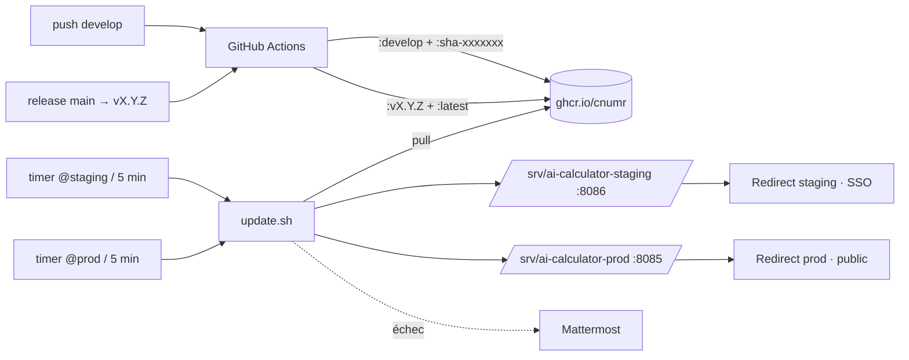

# Déploiement continu sur le VPS GreenIT (staging et prod) — Design

Statut : validé (brainstorming du 11/11/2026), planifié : `.superpowers/plans/2026-11-11-deploiement-vps.md` (écarts du plan reportés ici). Branche : `feat/deploiement-vps` (depuis `develop`). Issue : cnumr/ai-calculator#29, option C.

## Contexte

L'issue #29 demande un déploiement automatique sur le VPS de l'association GreenIT (`yunohost.greenit.eco`, Debian 12, x86_64, YunoHost, Docker 29, Compose v5). Aujourd'hui le dépôt construit les images sur place (`docker-compose.yml` avec `build:`) et `release.yml` ne fait que taguer et créer la GitHub Release. Rien n'est publié sur un registre, rien n'est déployé.

État observé sur le VPS (lecture seule, 11/11/2026) : ports 8000 et 8002 pris, 8085 et 8086 libres ; projets Compose existants dans `/srv/mcp-nr/` ; deux apps Redirect déjà en place ; `ghcr.io` et `api.github.com` joignables en sortie ; compte `debian` dans `docker` et `sudo` (`NOPASSWD: ALL`).

## Décisions

| Sujet | Choix |
|---|---|
| Mode de déploiement | **Option C** : le VPS tire lui-même les images. Aucune connexion entrante depuis GitHub, aucun secret SSH dans GitHub. |
| Environnements | **staging** suit `develop` ; **prod** suit la dernière GitHub Release (version épinglée). |
| Emplacement | `/srv/ai-calculator-prod` et `/srv/ai-calculator-staging` (cohérent avec `/srv/mcp-nr/`). |
| Ports | `127.0.0.1:8085` (prod), `127.0.0.1:8086` (staging). Seul le frontend publie un port. |
| Compte | Compte **système** `ai-calculator` créé en ligne de commande (pas un utilisateur YunoHost), dans le groupe `docker`, sans mot de passe, sans shell, sans SSH. |
| Registre | Images **publiques** sur `ghcr.io/cnumr/` : aucun identifiant sur le VPS. Création de packages publics déjà autorisée dans l'organisation `cnumr`. |
| Alertes | **Webhook Mattermost** (format compatible Slack), URL dans le `.env`. URL vide = logs seulement. |
| Domaines | `ia-calculator.greenit.eco` (prod, public) et `ia-calculator-staging.greenit.eco` (staging, réservé aux utilisateurs YunoHost). Zone DNS chez Infomaniak. |
| Domaine prod existant | `ia-calculator.greenit.eco` pointe aujourd'hui vers l'**ancien POC** (page unique, cf. `AGENTS.md`), hébergé chez Infomaniak (`83.166.133.33`). Il est **basculé vers le VPS le jour de la mise en prod** ; l'ancien site disparaît. |
| Exécution sur le VPS | Tout en ligne de commande, par le Développeur via SSH, **après validation de Renaud**, en suivant `deploy/README.md`. |

## 1. Architecture



### Images

- `ghcr.io/cnumr/ai-calculator-backend` et `ghcr.io/cnumr/ai-calculator-frontend`, construites depuis les `Dockerfile.prod` existants, pour `linux/amd64` uniquement.
- Labels OCI posés par `docker/metadata-action`, dont `org.opencontainers.image.source=https://github.com/cnumr/ai-calculator` (utilisé par la purge, section 2).

| Événement | Tags publiés | `APP_BUILD` |
|---|---|---|
| push sur `develop` | `develop`, `sha-<7 car.>` | `<7 car. du commit>` |
| release (tag `vX.Y.Z` créé par `release.yml`) | `vX.Y.Z`, `latest` | vide |

### Workflows GitHub

- **`.github/workflows/build-images.yml`** (`workflow_call`) : entrées `ref`, `tags` et `app_build`. Il se connecte à ghcr avec `GITHUB_TOKEN` (`packages: write`), construit puis pousse les deux images. C'est le seul endroit qui sait construire.
- **`.github/workflows/images-develop.yml`** : sur `push` vers `develop`, il appelle `build-images.yml`.
- **`release.yml`** : on ajoute à la fin du job une étape qui lit la version de `package.json` et regarde si le tag `vX.Y.Z` pointe sur `HEAD`. La sortie `released` vaut `true` ou `false`, et la sortie `version` donne `vX.Y.Z`. Un second job `images` (`needs: release`, `if: released == 'true'`) appelle `build-images.yml`.
  - Raison : un tag créé avec `GITHUB_TOKEN` ne déclenche pas d'autre workflow. On ne se fie pas non plus à la sortie `published` de `changesets/action`, incertaine avec un script de publication maison.
- La GitHub Release est créée **avant** la fin du build. Le VPS peut donc voir une release dont l'image n'existe pas encore. Ce cas est traité comme une attente, pas comme un échec (section 2).

### Version affichée

- Le pied de page affiche déjà `__APP_VERSION__`, tiré de `package.json` au build.
- `frontend/vite.config.ts` lit `process.env.APP_BUILD`. S'il est non vide, la version devient `X.Y.Z+sha.<APP_BUILD>`.
- `frontend/Dockerfile.prod` déclare `ARG APP_BUILD=""` et le passe à l'étape `npm run build`.
- Résultat : en prod, on voit `0.4.0`. En staging, on voit `0.4.0+sha.ab12cd3`. Cela suffit à prouver quelle version tourne.

### Compose de déploiement : `deploy/compose.yml`

- Les services `backend` et `frontend` utilisent `image: ghcr.io/cnumr/ai-calculator-<svc>:${IMAGE_TAG}`. Pas de `build:`.
- `frontend` publie `127.0.0.1:${HTTP_PORT}:80`. `backend` ne publie aucun port, nginx le joint par `http://backend:8000`, comme aujourd'hui.
- Healthchecks :
  - `backend` : script Python `urllib` sur `http://127.0.0.1:8000/api/use-cases`, car l'image ne contient pas `curl`.
  - `frontend` : `wget -qO- http://127.0.0.1/api/use-cases`.
  - `frontend.depends_on.backend.condition: service_healthy`.
- `restart: unless-stopped`.
- **Logs** sur les deux services : `driver: local`, `max-size: 10m`, `max-file: 5`. Cela fait 50 Mo au plus par conteneur, 200 Mo pour les deux environnements, avec rotation automatique.
- Le `docker-compose.yml` racine (build local, Synology) **ne change pas**.

## 2. `deploy/update.sh`

Usage :
- `update.sh <staging|prod>`
- `update.sh prod <vX.Y.Z>`
- `update.sh prod --unpin`
- options globales : `--dry-run` et `--verbose`

Le script est écrit en Bash, avec `set -euo pipefail`. Il ne dépend que de `docker`, `curl`, `flock` et `jq`. `jq` est un prérequis vérifié en 4.1 et installé en 4.2 s'il manque.

### Fichiers par environnement

`/srv/ai-calculator-<env>/` contient :
- `compose.yml` : copie de `deploy/compose.yml` ;
- `update.sh` : copie de `deploy/update.sh` ;
- `.env`.

| Variable du `.env` | Rôle |
|---|---|
| `COMPOSE_PROJECT_NAME` | `ai-calculator-prod` / `ai-calculator-staging` |
| `HTTP_PORT` | `8085` / `8086` |
| `IMAGE_TAG` | Tag en service (`develop` en staging, `vX.Y.Z` en prod) |
| `PREVIOUS_TAG` | Tag précédent, cible du retour arrière (prod) |
| `PINNED` | `true` après un retour arrière manuel : la tâche planifiée ne change plus la version |
| `ALERT_WEBHOOK_URL` | Webhook Mattermost ; vide = pas d'alerte |
| `FAILED_TARGET` | Écrit par le script après un échec. Prod : la release en échec, qui n'est pas retentée (ni ré-alertée) tant qu'une nouvelle release ne sort pas. Staging : les identifiants des images en échec, en attente d'un nouveau push. Effacé après une bascule réussie. Une version passée à la main (`update.sh prod vX`) l'ignore. |

### Déroulé

1. **Verrou** : `flock -n` sur le `.env`. Si une exécution tourne déjà, le script sort sans rien faire.
2. **Cible**
   - staging : `develop`.
   - prod avec `vX.Y.Z` en argument : cette version, et le script écrit `PINNED=true`.
   - prod avec `--unpin` : le script retire `PINNED`, puis continue comme sans argument.
   - prod sans argument : si `PINNED=true`, il écrit « version figée sur vX » et sort. Sinon, il lit `tag_name` sur `https://api.github.com/repos/cnumr/ai-calculator/releases/latest`, sans jeton (12 appels par heure, limite anonyme à 60). Si l'API est en erreur, il écrit un avertissement et sort sans rien changer, sans alerte.
3. **Rien à faire ?**
   - staging : `docker compose pull`, puis comparaison des images des conteneurs en service avec les images locales `:develop`. Identiques : il sort. Égales à `FAILED_TARGET` : il sort aussi. En `--dry-run`, pas de `pull`.
   - prod : si la cible est égale à `IMAGE_TAG`, ou à `FAILED_TARGET` (sans version passée à la main), il sort.
   - Ces sorties ne sont écrites qu'avec `--verbose`.
4. **Image disponible ?** En prod, `docker manifest inspect` (lecture du manifeste seul, aussi en `--dry-run`) sur les deux images de la cible. Absentes : l'image est encore en cours de build. Le script écrit un message et sort, sans alerte et sans rien modifier. Il réessaiera au prochain passage. Exception : une version passée à la main et introuvable fait sortir en erreur (code 1), sans écrire `PINNED`.
5. **Bascule**
   - prod : `PREVIOUS_TAG` reçoit l'ancien `IMAGE_TAG`, et `IMAGE_TAG` reçoit la cible.
   - puis `docker compose pull` et `docker compose up -d`.
6. **Contrôle** : jusqu'à 12 essais de `curl -fsS http://127.0.0.1:${HTTP_PORT}/api/use-cases`, espacés de 5 s. La réponse doit être un JSON valide.
7. **Échec**
   - prod : retour à `PREVIOUS_TAG`, `up -d`, nouveau contrôle.
     - Si le retour réussit, alerte : « prod : vX en échec, retour à vY ».
     - Si le retour échoue aussi, alerte : « prod indisponible ».
     - Code de sortie non nul.
   - prod : `FAILED_TARGET` reçoit la cible.
   - staging : alerte « staging : déploiement de <sha> en échec », et `FAILED_TARGET` reçoit les identifiants des images. Pas de retour arrière : le prochain push sur `develop` réparera le staging.
8. **Purge** : après une bascule réussie, `docker image prune -af --filter label=org.opencontainers.image.source=https://github.com/cnumr/ai-calculator`. Seules les images du projet devenues inutiles sont supprimées, celles des autres projets ne sont pas touchées. `-a` est nécessaire : sans lui, les anciennes versions taguées ne sont jamais supprimées. L'image de `PREVIOUS_TAG` part donc aussi ; un retour arrière la retélécharge avec `up -d` (quelques secondes de plus).

### Alerte

L'alerte est un `curl` `POST` en JSON `{"text": "..."}` vers `ALERT_WEBHOOK_URL`. Le texte contient :
- l'environnement ;
- la version tentée et la version restaurée ;
- les 20 dernières lignes de `docker compose logs`.

Si le webhook échoue, l'erreur est écrite dans les logs et le code de sortie ne change pas.

### `--dry-run`

Avec `--dry-run`, le script fait les étapes 1 à 4 en lecture seule et affiche la décision : rien à faire, bascule vers X, attente de l'image, ou version figée. Il ne fait ni `pull` de bascule, ni `up`, ni écriture dans le `.env`.

## 3. systemd

`deploy/systemd/ai-calculator-update@.service` :
- `Type=oneshot`, `User=ai-calculator`, `Group=ai-calculator`.
- `ExecStart=/srv/ai-calculator-%i/update.sh %i`.
- `NoNewPrivileges=yes`, `ProtectSystem=strict`, `ReadWritePaths=/srv/ai-calculator-%i`, `ProtectHome=yes`, `PrivateTmp=yes`.

`deploy/systemd/ai-calculator-update@.timer` :
- `OnBootSec=2min`, `OnUnitActiveSec=5min`.

Ces modèles sont instanciés en `@staging` et `@prod`.

Les logs du script vont dans le journal système. Sa limite et sa purge sont celles du serveur, et on ne les modifie pas.

## 4. Actions sur le VPS (à documenter dans `deploy/README.md`)

`deploy/README.md` est **la seule procédure de référence**. Toute action sur le VPS en vient. Si une commande diffère à l'exécution (argument YunoHost, chemin, droit), le README est corrigé dans la même PR. Chaque étape indique **qui** l'exécute, **la commande**, **comment vérifier** et **comment annuler**.

### 4.1 Vérifications préalables (lecture seule)

- `docker --version` et `docker compose version`.
- `ss -ltn` : les ports 8085 et 8086 sont libres.
- `command -v curl jq flock`.
- `journalctl --disk-usage`.
- `cat /etc/docker/daemon.json` : pour savoir s'il y a déjà une limite de logs Docker globale.
- `curl -sI https://ghcr.io/v2/`.

### 4.2 Installation (Développeur via SSH, après validation)

0. **Paquet manquant** (si 4.1 l'a signalé) : `sudo apt install jq`.
1. **Compte**
   ```
   sudo adduser --system --group --no-create-home --shell /usr/sbin/nologin ai-calculator
   sudo usermod -aG docker ai-calculator
   ```
2. **Dossiers**, pour chaque `<env>` :
   - `sudo install -d -o root -g root -m 755 /srv/ai-calculator-<env>`
   - copier `compose.yml` et `update.sh` en `root:root`, avec les modes `644` et `755` ;
   - créer `.env` en `ai-calculator:ai-calculator`, mode `600`.
3. **systemd** :
   - copier les deux modèles dans `/etc/systemd/system/` ;
   - `systemctl daemon-reload` ;
   - premier test : `sudo -u ai-calculator /srv/ai-calculator-staging/update.sh staging --dry-run`, puis la même commande sans `--dry-run` ;
   - `systemctl enable --now ai-calculator-update@staging.timer`.
   - On procède de même pour la prod, en accès local seulement, avant la bascule DNS.
4. **Domaines YunoHost** :
   - `sudo yunohost domain add <domaine>` ;
   - après la propagation DNS : `sudo yunohost domain cert install <domaine>`.
5. **Apps Redirect** (arguments lus dans le manifeste de `YunoHost-Apps/redirect_ynh`) :
   - prod : `sudo yunohost app install redirect --label "AI Calculator" --args "domain=ia-calculator.greenit.eco&path=/&redirect_type=reverseproxy&target=http://127.0.0.1:8085&init_main_permission=visitors"` ;
   - staging : même commande avec le domaine staging, `target=http://127.0.0.1:8086` et `init_main_permission=all_users` (comptes YunoHost).
   - La version du catalogue sur le VPS n'est pas vérifiée : si un argument est refusé, on lit les réglages d'une app Redirect existante (`sudo yunohost app setting <id> redirect_type`), puis on corrige la commande et le README.
   - Changer la visibilité plus tard : `sudo yunohost user permission update <app>.main --add visitors` ou `--remove visitors`.

### 4.3 Hors VPS

- **Infomaniak** (admin de la zone `greenit.eco`) :
  - **maintenant** : créer `A ia-calculator-staging → 179.237.83.184` ;
  - **jour J** : remplacer l'enregistrement A de `ia-calculator` par `179.237.83.184`, puis installer le certificat (étape 4.2.4).
- **GitHub** (admin de `cnumr`) : après la première publication, passer les packages `ai-calculator-backend` et `ai-calculator-frontend` en **Public**. La création de packages publics est déjà autorisée.
- **Mattermost** : créer un incoming webhook dans le canal choisi, puis mettre son URL dans les deux `.env`.

### 4.4 Ordre de mise en service

1. Staging de bout en bout : DNS, Redirect, SSO, timer.
2. Prod testée en local sur le VPS (`curl 127.0.0.1:8085`).
3. Bascule DNS de la prod.

### 4.5 Exploitation (sections du README)

- Lire les logs :
  - `journalctl -u ai-calculator-update@prod` ;
  - `docker compose -p ai-calculator-prod logs`.
- Forcer une mise à jour : `sudo systemctl start ai-calculator-update@prod`.
- Revenir à une version :
  - `sudo -u ai-calculator /srv/ai-calculator-prod/update.sh prod vX.Y.Z` ;
  - reprendre le suivi automatique : `… prod --unpin`.
- Mettre à jour `update.sh` ou `compose.yml` : copie manuelle depuis une release, par un admin. Le compte `ai-calculator` ne peut pas modifier ses scripts.
- Changer le webhook d'alerte.
- Désinstaller :
  - arrêter et désactiver les timers ;
  - `docker compose down` ;
  - supprimer les apps Redirect ;
  - supprimer les dossiers et le compte.

## 5. Documentation dans le dépôt

- `deploy/README.md` : la procédure de la section 4, complète et rejouable.
- `docs/PRODUCTION.md` : une nouvelle section « Déploiement continu sur le VPS GreenIT », avec le schéma, les deux environnements et un lien vers `deploy/README.md`. L'installation manuelle existante reste en place, pour le Synology et les autres serveurs.
- Les workflows `build-images.yml`, `images-develop.yml` et `release.yml` sont commentés.

## 6. Tests et critères d'acceptation

**CI** : workflow dédié `deploy-checks.yml`, lancé sur les PR qui touchent `deploy/**` ou `.github/workflows/**`, et appelé (`workflow_call`) par `images-develop.yml` avant la construction :
- `shellcheck` sur `update.sh`, le test et les faux binaires ;
- `bash deploy/tests/update_test.sh` : tests de `update.sh` avec un faux `docker` et un faux `curl` (`deploy/tests/fake-bin/`), sans réseau ni conteneur ;
- `docker compose -f deploy/compose.yml --env-file deploy/env.example config --quiet`.

**`deploy/env.example`** (et non `deploy/.env.example`, que le `.gitignore` ignore avec `.env.*`) : il sert au test CI et de modèle pour l'installation.

**Recette sur le VPS**
1. Un push sur `develop` est en ligne sur `ia-calculator-staging.greenit.eco` en moins de 10 minutes. Le pied de page affiche `+sha.<commit>`.
2. Une release `vX.Y.Z` est en ligne en prod en moins de 10 minutes, et le pied de page affiche `X.Y.Z`.
3. Échec et retour arrière : couverts par `deploy/tests/update_test.sh` en CI, plus un message de test envoyé au webhook. On ne publie pas de release volontairement cassée.
4. `update.sh prod vX.Y.Z` fige la version, la tâche planifiée la laisse en place, et `--unpin` revient à la dernière release.
5. Le staging demande une connexion YunoHost, la prod est publique.
6. `docker inspect` montre le driver de logs `local` avec ses limites, sur les quatre conteneurs.

## Écoconception

- Tirage léger : `api.github.com` en prod et un `pull` de manifeste en staging, toutes les 5 min. Aucun téléchargement d'image s'il n'y a pas de changement.
- Images `amd64` uniquement, purge des images du projet après chaque bascule, logs limités à 200 Mo.
- Le plan applique `ecocode` aux fichiers de build et de configuration (workflows, Compose, Dockerfile).

## Hors périmètre

- Mise à jour sans coupure : quelques secondes d'interruption sont acceptables.
- Migrations de données : l'app n'a pas de base.
- Déploiement déclenché par GitHub (options A et B de l'issue), runner auto-hébergé.
- Images arm64.
- Purge des anciennes versions sur ghcr : à traiter plus tard si le volume le justifie.
- Modification de la limite du journal système ou de `/etc/docker/daemon.json`.
